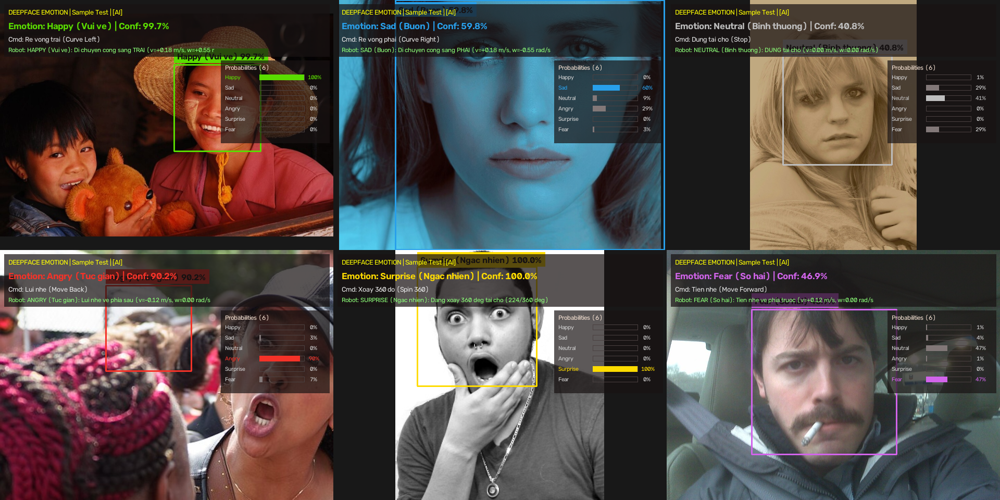
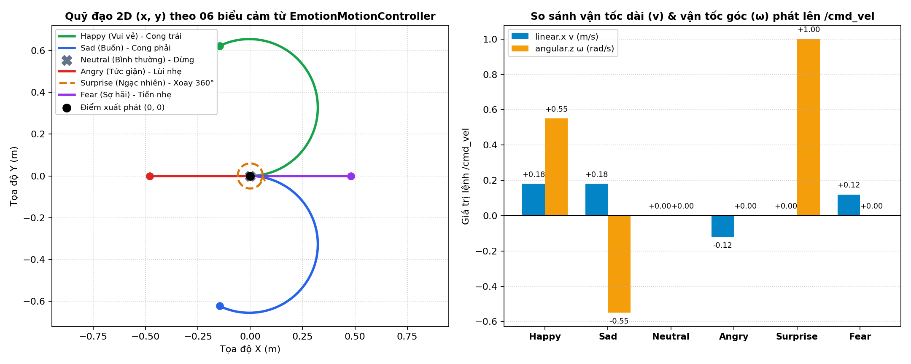
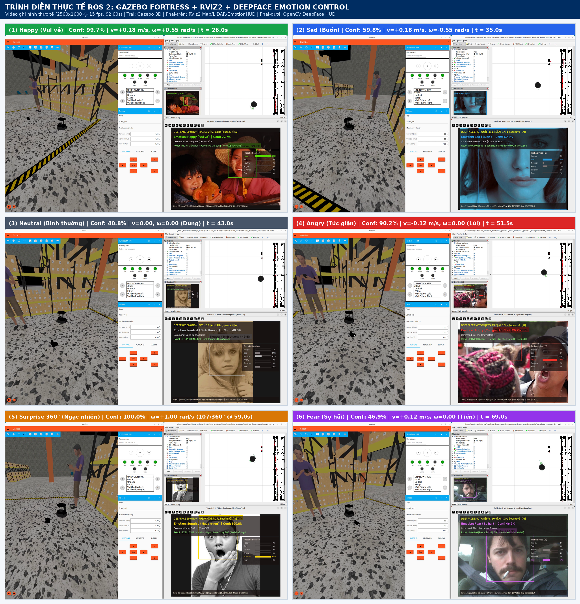
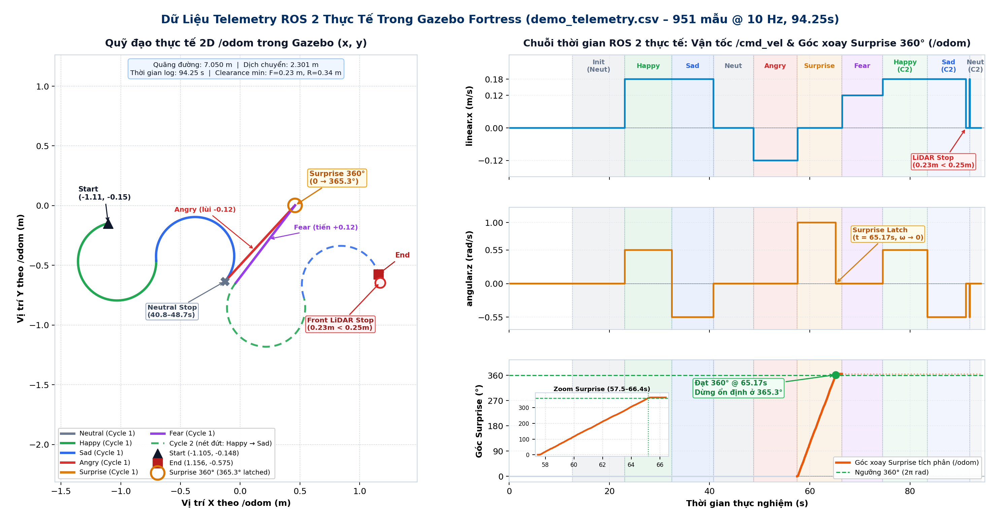

# BÁO CÁO KỸ THUẬT: BÀI THỰC HÀNH SỐ 8
# NHẬN DIỆN BIỂU CẢM KHUÔN MẶT BẰNG AI (DEEPFACE + OPENCV) VÀ ĐIỀU KHIỂN QUỸ ĐẠO TURTLEBOT 4
## *(Real-Time Facial Expression Recognition & Trajectory Control for TurtleBot 4 in ROS 2)*

**Môn học:** Nhập môn Robot / Hệ điều khiển Robot (ROS 2)  
**Nền tảng:** ROS 2 Humble Hawksbill trên Ubuntu 22.04 LTS (Gazebo Fortress + RViz2)  
**Robot thực hiện:** TurtleBot 4 Standard (iRobot Create 3 Base + RPLiDAR 2D + Camera OAK-D)  
**Công nghệ AI & Thị giác máy tính:** DeepFace (`facial_expression_model_weights.h5` – FER-2013 CNN), `tf-keras` / TensorFlow & OpenCV (`haarcascade_frontalface_default.xml`)  
**Sinh viên thực hiện:** Nguyễn Quang Tuân – MSSV: 23020767  
**Giảng viên hướng dẫn:** PGS.TS. Hoàng Văn Xiêm, CN. Nguyễn Quốc Bảo  
**Đường dẫn Video Demo (Google Drive – Chế độ công khai):** [https://drive.google.com/drive/folders/1vl4O0C9A4C3Ed_HwHmJAeVCzwEQZulCx?usp=drive_link](https://drive.google.com/drive/folders/1vl4O0C9A4C3Ed_HwHmJAeVCzwEQZulCx?usp=drive_link)  
**Đường dẫn GitHub Repository (Public):** [https://github.com/Tuan404cl/Turtlebot_sim_test5](https://github.com/Tuan404cl/Turtlebot_sim_test5)  
**Báo cáo PDF:** [docs/bao_cao_bai_tap_08.pdf](bao_cao_bai_tap_08.pdf)  

---

## I. SƠ ĐỒ KIẾN TRÚC HỆ THỐNG

Hệ thống được thiết kế theo kiến trúc phân tầng mô-đun hóa gồm 3 tầng độc lập trên nền tảng **ROS 2 Humble**, tách biệt hoàn toàn giữa luồng suy luận thị giác máy tính tốc độ cao (`emotion_recognition_node`) và vòng lặp điều khiển động học thời gian thực (`emotion_control_node` @ `20 Hz`):

```
+---------------------------------------------------------------------------------------------------+
| TẦNG 1: THU NHẬN HÌNH ẢNH & NHẬN DIỆN BIỂU CẢM KHUÔN MẶT BẰNG AI (emotion_recognition_node)       |
|  [Webcam /dev/video0 hoặc Chuỗi ảnh mẫu 640x480] ---> [1-Slot Latest-Frame Buffer (Non-blocking)] |
|  ---> [Worker Thread: DeepFace.analyze(actions=['emotion'], detector_backend='opencv')]           |
|  ---> [Chuẩn hóa 06 nhãn: Happy, Sad, Neutral, Angry, Surprise, Fear (Gộp disgust -> Neutral)]    |
|  ---> [Bộ lọc EmotionStabilizer: Sliding Window (N=4) + Min Conf (0.30) + Debounce (K=2) + 1.5s]  |
|  ---> [Giao diện HUD OpenCV (~30 FPS): Khung mặt, Nhãn EN/VI, Biểu đồ 6 thanh xác suất, Phím tắt] |
+---------------------------------------------------------------------------------------------------+
                                                 |
                                                 | Publish: /detected_emotion (std_msgs/msg/String)
                                                 |          /detected_emotion_info (JSON metadata)
                                                 |          /emotion/detections/image (sensor_msgs/Image)
                                                 v
+---------------------------------------------------------------------------------------------------+
| TẦNG 2: ĐIỀU KHIỂN QUỸ ĐẠO CHUYỂN ĐỘNG & AN TOÀN ROBOT (emotion_control_node)                     |
|  +---------------------------------------------------------------------------------------------+  |
|  | Bộ điều khiển chuyển động EmotionMotionController (Chu kỳ điều khiển 20 Hz / 50 ms):        |  |
|  |   - Happy    (Vui vẻ)      ---> Quỹ đạo cong sang trái  (v = +0.18 m/s, w = +0.55 rad/s)    |  |
|  |   - Sad      (Buồn)        ---> Quỹ đạo cong sang phải  (v = +0.18 m/s, w = -0.55 rad/s)    |  |
|  |   - Neutral  (Bình thường) ---> Dừng tại chỗ tức thời   (v =  0.00 m/s, w =  0.00 rad/s)    |  |
|  |   - Angry    (Tức giận)    ---> Lùi nhẹ về phía sau     (v = -0.12 m/s, w =  0.00 rad/s)    |  |
|  |   - Surprise (Ngạc nhiên)  ---> Xoay 1 vòng 360° (2π)   (v =  0.00 m/s, w = +1.00 rad/s)    |  |
|  |   - Fear     (Sợ hãi)      ---> Tiến nhẹ về phía trước  (v = +0.12 m/s, w =  0.00 rad/s)    |  |
|  +---------------------------------------------------------------------------------------------+  |
|  + Tích phân góc Yaw từ /odom (Surprise 360°) + Watchdog Timeout (1.5s) + Bảo vệ LiDAR /scan      |
+---------------------------------------------------------------------------------------------------+
                                                 |
                                                 | Publish: /cmd_vel (geometry_msgs/msg/Twist @ 20 Hz)
                                                 v
+---------------------------------------------------------------------------------------------------+
| TẦNG 3: MÔ PHỎNG VẬT LÝ GAZEBO FORTRESS, ĐỊNH VỊ AMCL & HIỂN THỊ TRỰC QUAN RVIZ2                  |
|  - Gazebo Fortress (world: warehouse): TurtleBot 4 Standard (Create 3 safety_override='full')     |
|  - Auto Undock & Open Space: Tự động rời trạm sạc và tiến 0.90m ra khu vực trung tâm rộng thoáng  |
|  - RViz2 + Map Server + AMCL: Nạp bản đồ map.yaml, hiển thị RobotModel, /scan & quỹ đạo di chuyển |
+---------------------------------------------------------------------------------------------------+
```

---

## II. GIẢI THÍCH CHI TIẾT CÁC NODE, TOPIC VÀ THUẬT TOÁN XỬ LÝ

### 1. Các ROS 2 Node trong hệ thống (`turtlebot4_practice4`)

1. **`emotion_recognition_node` ([`emotion_recognition_node.py`](../turtlebot4_practice4/emotion_recognition_node.py) – Tầng 1):**
   * **Cơ chế suy luận bất đồng bộ (Asynchronous 1-Slot Buffer):** Việc chạy mạng CNN của DeepFace trên CPU mất khoảng $60\text{--}120\text{ ms}$/khung hình. Để giao diện camera OpenCV không bị giật lag, luồng chính đọc camera ở tốc độ $\sim 30\text{ FPS}$ và đẩy khung hình mới nhất vào bộ đệm 1 phần tử (`_pending_frame`), trong khi luồng nền (`deepface_emotion_worker`) liên tục gọi `DeepFace.analyze(frame, actions=['emotion'], enforce_detection=False, detector_backend='opencv', silent=True)`.
   * **Chuẩn hóa 06 biểu cảm mục tiêu (`canonicalize_emotion_scores`):** Mô hình gốc của DeepFace phân loại 7 lớp cảm xúc FER-2013 (`angry`, `disgust`, `fear`, `happy`, `sad`, `surprise`, `neutral`). Hàm chuẩn hóa gộp xác suất lớp `disgust` vào `Neutral` và chuẩn hóa lại tổng xác suất bằng $1.0$ trên đúng **06 trạng thái** yêu cầu của đề bài: `Happy`, `Sad`, `Neutral`, `Angry`, `Surprise`, `Fear`.
   * **Bộ lọc chống nhiễu 3 cấp (`EmotionStabilizer`):**
     * *Trung bình trượt xác suất (`smoothing_window = 4`):* Lấy trung bình cộng vector xác suất của 4 lần suy luận liên tiếp:
       $$\bar{P}_c(t) = \frac{1}{N} \sum_{k=0}^{N-1} P_c(t - k), \qquad c \in \{\text{Happy, Sad, Neutral, Angry, Surprise, Fear}\}$$
     * *Ngưỡng tin cậy (`min_confidence = 0.30`) & Khử rung (`debounce_frames = 2`):* Chỉ chấp nhận chuyển trạng thái khi cảm xúc có xác suất cao nhất đạt $\bar{P}_c \ge 0.30$ và xuất hiện liên tiếp ít nhất 2 chu kỳ suy luận.
     * *Watchdog mất khuôn mặt (`face_lost_timeout_sec = 1.5s`):* Nếu không phát hiện khuôn mặt trong $1.5\text{ s}$, node tự động đưa nhãn xuất ra về `Neutral` để dừng robot an toàn.
   * **Tự động kích hoạt môi trường ảo (`_ensure_emotion_venv`):** Tự động chuyển đổi sang interpreter `/home/tuan/turtelbot4_ws/.venv_emotion/bin/python3` (chứa `deepface==0.0.105`, `tf-keras==2.21.0`, `tensorflow==2.21.0`) khi người dùng gọi trực tiếp qua `ros2 run`, giúp bảo toàn hoàn toàn các thư viện `mediapipe==1.1.1` và `ultralytics==8.4.177` ở môi trường hệ thống.

2. **`emotion_control_node` ([`emotion_control_node.py`](../turtlebot4_practice4/emotion_control_node.py) – Tầng 2):**
   * Subscribe `/detected_emotion` (`std_msgs/msg/String`), `/odom` (`nav_msgs/msg/Odometry`), `/scan` (`sensor_msgs/msg/LaserScan`) và phát lệnh điều khiển vận tốc lên `/cmd_vel` (`geometry_msgs/msg/Twist`) ở tần số cố định `20 Hz` ($50\text{ ms}$).
   * **Mở khóa chuyển động lùi trên đế iRobot Create 3:** Tự động gọi dịch vụ `/motion_control/set_parameters` thiết lập `safety_override = 'full'` để cho phép robot thực hiện lệnh lùi (`linear.x = -0.12 m/s`) khi nhận biểu cảm `Angry`.
   * **Thuật toán xoay đúng 1 vòng $360^\circ$ tại chỗ cho biểu cảm `Surprise`:**
     * Chuyển đổi quaternion $(x, y, z, w)$ từ `/odom` sang góc hướng phẳng $\psi$ (`yaw`):
       $$\psi = \operatorname{atan2}\bigl(2(wz + xy),\; 1 - 2(y^2 + z^2)\bigr)$$
     * Tích phân độ biến thiên góc quay có dấu theo chiều xoay $\text{spin\_dir} = \operatorname{sgn}(\omega)$ qua hàm chuẩn hóa góc `normalize_angle` $\Delta\psi \in [-\pi, \pi]$ để xử lý trơn tru điểm nhảy $\pm\pi$:
       $$\Theta_{\text{accum}}(t) = \sum \operatorname{sgn}(\omega)\cdot\operatorname{atan2}\bigl(\sin(\psi_t - \psi_{t-1}), \cos(\psi_t - \psi_{t-1})\bigr)$$
     * Khi $\Theta_{\text{accum}}(t) \ge 2\pi\text{ rad}$ ($360^\circ$, hoặc hết thời gian fallback $T = \frac{2\pi}{|\omega|} \approx 6.28\text{ s}$ nếu chưa có `/odom`), robot tự động dừng (`Twist(0.0, 0.0)`) và khóa chốt (`surprise_latched = True`) để không xoay lặp vô tận khi người dùng vẫn giữ biểu cảm `Surprise`. Đặc biệt, nếu nhận `Neutral` giữa chừng, chu trình xoay bị hủy ngay lập tức.
   * **Bảo vệ an toàn LiDAR (`/scan`) & Watchdog (`signal_timeout_sec = 1.5s`):** Phân tách vùng quét phía trước ($\pm 30^\circ$) và phía sau ($\ge 150^\circ$). Khi khoảng cách vật cản $< 0.25\text{ m}$, tự động chặn thành phần vận tốc tiến (`Happy`, `Sad`, `Fear`) hoặc vận tốc lùi (`Angry`) nhưng vẫn cho phép xoay tại chỗ (`Surprise`).

---

### 2. Bảng tổng hợp các ROS 2 Topic cốt lõi

| Tên Topic | Kiểu Message | Tần số | Vai trò và luồng dữ liệu trong hệ thống |
| :--- | :--- | :--- | :--- |
| `/detected_emotion` | `std_msgs/msg/String` | 15 Hz | **Topic chính (Tầng 1 $\rightarrow$ Tầng 2):** Truyền nhãn biểu cảm chuẩn hóa (`Happy`, `Sad`, `Neutral`, `Angry`, `Surprise`, `Fear`). |
| `/detected_emotion_info` | `std_msgs/msg/String` | 15 Hz | Chuỗi JSON chứa `emotion`, `raw_emotion`, `confidence`, phân bố xác suất `scores` 6 lớp và `face_detected`. |
| `/emotion/detections/image` | `sensor_msgs/msg/Image` | 30 Hz | Khung hình BGR8 đã vẽ HUD, Bounding Box và biểu đồ 6 thanh xác suất để xem trên RViz2. |
| `/cmd_vel` | `geometry_msgs/msg/Twist` | 20 Hz | **Topic điều khiển vận tốc:** Phát vận tốc dài `linear.x` ($v$) và vận tốc góc `angular.z` ($\omega$) xuống TurtleBot 4. |
| `/emotion_robot_status` | `std_msgs/msg/String` | Khi đổi / 2 Hz | Truyền trạng thái thực thi của robot từ `emotion_control_node` về hiển thị trực tiếp trên HUD OpenCV. |
| `/odom` | `nav_msgs/msg/Odometry` | 20–62 Hz | Cung cấp góc hướng `yaw` thực tế để tích phân đủ $2\pi\text{ rad}$ ($360^\circ$) cho trạng thái `Surprise`. |
| `/scan` | `sensor_msgs/msg/LaserScan` | 10 Hz | Dữ liệu LiDAR $360^\circ$ phục vụ dừng tránh va chạm trước/sau ($< 0.25\text{ m}$). |

---

## III. BẢNG ÁNH XẠ 06 BIỂU CẢM KHUÔN MẶT VÀ QUỸ ĐẠO CHUYỂN ĐỘNG

| STT | Biểu cảm khuôn mặt | Nhãn trên `/detected_emotion` | Hành động của TurtleBot 4 theo yêu cầu | Vận tốc dài $v$ (`linear.x`) | Vận tốc góc $\omega$ (`angular.z`) | Đặc tính động học & Cơ chế thực thi |
| :---: | :--- | :---: | :--- | :---: | :---: | :--- |
| **1** | **Happy** *(Vui vẻ)* | `Happy` | Di chuyển theo quỹ đạo cong sang trái | $+0.18\text{ m/s}$ | $+0.55\text{ rad/s}$ | Quỹ đạo cung tròn lệch trái bán kính $R = \frac{v}{|\omega|} \approx 0.327\text{ m}$ ($\omega > 0$ ngược chiều kim đồng hồ). |
| **2** | **Sad** *(Buồn)* | `Sad` | Di chuyển theo quỹ đạo cong sang phải | $+0.18\text{ m/s}$ | $-0.55\text{ rad/s}$ | Quỹ đạo cung tròn lệch phải bán kính $R = \frac{v}{|\omega|} \approx 0.327\text{ m}$ ($\omega < 0$ cùng chiều kim đồng hồ). |
| **3** | **Neutral** *(Bình thường)* | `Neutral` | Dừng tại chỗ | $0.00\text{ m/s}$ | $0.00\text{ rad/s}$ | Phát vận tốc $(0, 0)$ tức thời; hủy ngay chu trình xoay `Surprise` nếu đang thực thi. |
| **4** | **Angry** *(Tức giận)* | `Angry` | Lùi nhẹ về phía sau | $-0.12\text{ m/s}$ | $0.00\text{ rad/s}$ | Lùi thẳng tốc độ êm ($0.12\text{ m/s}$), mở khóa Create 3 `safety_override='full'`, giám sát LiDAR phía sau $\ge 0.25\text{ m}$. |
| **5** | **Surprise** *(Ngạc nhiên)* | `Surprise` | Xoay một vòng tại chỗ ($360^\circ$) | $0.00\text{ m/s}$ | $+1.00\text{ rad/s}$ | Xoay tại chỗ đến khi tích phân góc có dấu $\operatorname{sgn}(\omega)\Delta\psi$ từ `/odom` đạt đúng $2\pi\text{ rad}$ ($360^\circ$) rồi tự động dừng (Edge-Triggered Latch). |
| **6** | **Fear** *(Sợ hãi)* | `Fear` | Tiến nhẹ về phía trước | $+0.12\text{ m/s}$ | $0.00\text{ rad/s}$ | Tiến thẳng tốc độ êm ($0.12\text{ m/s}$), giám sát khoảng trống LiDAR phía trước $\ge 0.25\text{ m}$. |

---

## IV. HÌNH ẢNH MINH HỌA KẾT QUẢ THỰC NGHIỆM & KIỂM THỬ TỰ ĐỘNG

### 1. Kết quả nhận diện bằng DeepFace trên bộ 06 ảnh khuôn mặt thực tế



*Hình 1: Giao diện HUD OpenCV của `emotion_recognition_node` khi phân tích bộ ảnh khuôn mặt người thật tải từ Internet qua mô hình DeepFace (`detector_backend='opencv'`), hiển thị khung giới hạn khuôn mặt (Bounding Box), nhãn cảm xúc Anh–Việt, độ tin cậy (`Confidence %`), biểu đồ 6 thanh xác suất thời gian thực và trạng thái lệnh điều khiển gửi xuống TurtleBot 4.*

---

### 2. Quỹ đạo chuyển động 2D $(x, y)$ và thông số vận tốc `/cmd_vel` của 06 trạng thái



*Hình 2: (Trái) Quỹ đạo di chuyển 2D $(x, y)$ của robot TurtleBot 4 tương ứng với 06 biểu cảm từ điểm xuất phát $(0, 0)$: nhánh cong trái màu xanh lá (`Happy`), nhánh cong phải màu xanh dương (`Sad`), điểm dừng tại gốc (`Neutral`), đoạn lùi thẳng màu đỏ (`Angry`), vòng xoay tại chỗ $360^\circ$ màu cam (`Surprise`) và đoạn tiến thẳng màu tím (`Fear`); (Phải) Biểu đồ đối chiếu vận tốc dài `linear.x` ($v$) và vận tốc góc `angular.z` ($\omega$) phát lên `/cmd_vel`.*

---

### 3. Trình diễn thực tế toàn hệ thống trong Gazebo Fortress + RViz2 & Telemetry ROS 2

Hệ thống đã được chạy trình diễn tích hợp trực tiếp (**Live Demo** – không dùng mô phỏng giả lập rời rạc) với **Gazebo Fortress** (`warehouse` world, robot `turtlebot4` tự động `Auto Undock` ra không gian trống và bật `safety_override='full'`), **RViz2** (`map.yaml`, `RobotModel`, `LaserScan`, `Amcl Particle Swarm` và panel `EmotionHUD` tích hợp), cùng **OpenCV DeepFace HUD** chạy luồng nhận diện AI theo chuỗi 06 ảnh khuôn mặt thực tế (`sample_hold_sec = 8.5s`, `use_sim_time = false`).

* **Video Demo ghi hình trực tiếp:** `/home/tuan/Videos/emotion_control_demo.mp4` (`2560x1600`, codec `H.264 High / yuv420p`, `15 fps`, `1389` khung hình, thời lượng `92.60 s`, dung lượng `33,621,221 bytes` / `32.06 MiB`).
* **Link nộp bài công khai (Google Drive):** [https://drive.google.com/drive/folders/1vl4O0C9A4C3Ed_HwHmJAeVCzwEQZulCx?usp=drive_link](https://drive.google.com/drive/folders/1vl4O0C9A4C3Ed_HwHmJAeVCzwEQZulCx?usp=drive_link)
* **Bố cục hiển thị 3 vùng trên màn hình `2560x1600` (`DP-4`):**
  * **Trái (`0, 0, 1440, 1600`):** Gazebo Fortress 3D bám theo robot (`/gui/follow` trên `turtlebot4`) kèm TurtleBot 4 HMI & Teleop.
  * **Phải-trên (`1440, 0, 1120, 760`):** RViz2 hiển thị bản đồ `map`, điểm quét `/scan`, mô hình robot 3D và panel `EmotionHUD`.
  * **Phải-dưới (`1440, 760, 1120, 840`):** Cửa sổ `TurtleBot 4 - AI Emotion Recognition (DeepFace)` hiển thị Bounding Box, độ tin cậy, 6 thanh xác suất và `/emotion_robot_status`.



*Hình 3: Ảnh ghép 6 khung hình cắt trực tiếp từ video `/home/tuan/Videos/emotion_control_demo.mp4` tương ứng 06 biểu cảm theo thứ tự thực nghiệm: `(1) Happy (26.0s)`, `(2) Sad (35.0s)`, `(3) Neutral (43.0s)`, `(4) Angry (51.5s)`, `(5) Surprise 360° (59.0s)` và `(6) Fear (69.0s)`, quan sát đồng thời cả Gazebo 3D, RViz2 và OpenCV HUD.*



*Hình 4: Dữ liệu đo thực tế từ ROS 2 trong Gazebo Fortress (`demo_telemetry.csv` – `951` dòng ghi tại `10 Hz` trong `94.25 s`): (Trái) Quỹ đạo 2D `/odom` từ điểm xuất phát `(-1.105, -0.149) m` tới điểm dừng `(1.156, -0.575) m` với tổng quãng đường `7.050 m` (dịch chuyển ròng `2.301 m`); (Phải) Chuỗi thời gian `linear.x`, `angular.z` và góc xoay tích phân `Surprise 360°` đạt `365.261°` (khóa chốt dừng tại `360°` ở `t = 65.17 s`).*

#### Bảng tổng hợp Telemetry ROS 2 đo thực tế (`demo_telemetry.json`)

| Biểu cảm (`Emotion`) | Số mẫu (`10 Hz`) | Thời lượng (`s`) | Mean `linear.x` (Peak) | Mean `angular.z` (Peak) | Độ tin cậy AI TB | Diễn biến đo thực tế trong Gazebo |
| :--- | :---: | :---: | :---: | :---: | :---: | :--- |
| **`Neutral`** | 207 | `20.6634` | `0.0000` (`0.00`) | `0.0000` (`0.00`) | `69.78%` | Khởi tạo (`12.65..23.01s`) + Chu kỳ 1 (`40.75..48.74s`) + đuôi Chu kỳ 2 (`91.94..94.25s`) |
| **`Happy`** | 183 | `18.3336` | `+0.1800` (`0.18`) | `+0.5500` (`0.55`) | `96.34%` | Chu kỳ 1 (`23.01..32.43s`) + Chu kỳ 2 (`74.54..83.45s`), rẽ cong trái $R = 0.327\text{ m}$ |
| **`Sad`** | 168 | `16.8041` | `+0.1725` (`0.18`) | `-0.5271` (`0.55`) | `58.35%` | Chu kỳ 1 (`32.43..40.75s`) + Chu kỳ 2 (`83.45..91.94s`; kích hoạt phanh Front LiDAR ở `0.23m < 0.25m`) |
| **`Angry`** | 87 | `8.7224` | `-0.1200` (`0.12`) | `0.0000` (`0.00`) | `88.58%` | Chu kỳ 1 (`48.74..57.47s`), lùi thẳng êm với Create 3 `safety_override='full'` |
| **`Surprise`** | 90 | `8.9403` | `-0.0013` (`0.12`) | `+0.8444` (`1.00`) | `96.67%` | Chu kỳ 1 (`57.47..66.41s`), tích phân `/odom` đạt **`365.261°`**, tự dừng & latch ở `360°` (`t=65.17s`) |
| **`Fear`** | 81 | `8.1356` | `+0.1200` (`0.12`) | `0.0000` (`0.00`) | `46.34%` | Chu kỳ 1 (`66.41..74.54s`), tiến thẳng êm về phía trước (`+0.12 m/s`) |

* **Các chỉ số tổng hợp toàn phiên:**
  * **Chuỗi chuyển đổi thực tế (`10` transitions):** `Neutral` (`12.65s`) $\rightarrow$ `Happy` (`23.01s`) $\rightarrow$ `Sad` (`32.43s`) $\rightarrow$ `Neutral` (`40.75s`) $\rightarrow$ `Angry` (`48.74s`) $\rightarrow$ `Surprise` (`57.47s`) $\rightarrow$ `Fear` (`66.41s`) $\rightarrow$ Chu kỳ 2: `Happy` (`74.54s`) $\rightarrow$ `Sad` (`83.45s`) $\rightarrow$ `Neutral` (`91.94s`).
  * **Khoảng cách LiDAR `/scan` & Độ tin cậy AI:** Chu kỳ 1 hoàn toàn không va chạm; sang Chu kỳ 2 (`Sad`, `t = 91.17s`), bộ bảo vệ LiDAR tự động phanh robot khi khoảng cách phía trước giảm xuống `0.2289 m` ($< 0.25\text{ m}$), khoảng cách sau nhỏ nhất `0.3403 m`. Độ tin cậy trung bình AI đạt `75.96%` trên tổng `857` bản tin `/detected_emotion`.
  * **Tổng số bản tin ROS 2 ghi nhận:** `/detected_emotion = 857`, `/detected_emotion_info = 857`, `/emotion_robot_status = 322`, `/cmd_vel = 1,883`, `/odom = 4,948`, `/scan = 4,988`.

---

### 4. Kết quả kiểm thử tự động toàn diện (`41/41 Passed` với `pytest`)

Toàn bộ logic chuẩn hóa cảm xúc, bộ lọc `EmotionStabilizer`, ánh xạ vận tốc 6 trạng thái, tích phân góc quay $360^\circ$ vượt biên $\pm\pi$, hủy lệnh tức thời bằng `Neutral`, Watchdog timeout, bảo vệ LiDAR `/scan` và luồng giao tiếp ROS 2 Pub/Sub giữa 2 node đã được kiểm chứng tự động qua **41 kịch bản unit & integration test** trong [`test/test_emotion_control.py`](../test/test_emotion_control.py):

```bash
source /opt/ros/humble/setup.bash
source /home/tuan/turtelbot4_ws/install/setup.bash
python3 -m pytest -p no:anyio -v /home/tuan/turtelbot4_ws/src/turtlebot4_practice4/test/test_emotion_control.py
```

| Nhóm kiểm thử tự động (`test_emotion_control.py`) | Số lượng Test Case | Nội dung kiểm chứng kỹ thuật | Kết quả |
| :--- | :---: | :--- | :---: |
| `test_normalize_emotion[...]` | 25 | Chuẩn hóa tên 6 biểu cảm (hoa/thường, tiếng Việt, khoảng trắng), gộp `disgust` và nhãn lạ về `Neutral`. | **25 / 25 PASSED** |
| `test_canonicalize_emotion_scores_*` & `test_parse_deepface_result_*` | 2 | Chuẩn hóa vector xác suất 6 lớp tổng bằng $1.0$; xử lý trường hợp không có mặt (`face_confidence = 0`). | **2 / 2 PASSED** |
| `test_stabilizer_*` (Smoothing, Debounce, MinConf, Watchdog) | 4 | Cửa sổ trượt trung bình xác suất, khử rung `debounce_frames`, ngưỡng `min_confidence` và tự về `Neutral` sau $1.5\text{ s}$ mất mặt. | **4 / 4 PASSED** |
| `test_compute_twist_for_all_six_emotions` | 1 | Kiểm tra chính xác cặp $(v, \omega)$ trên `/cmd_vel` cho cả 6 biểu cảm (`Happy`, `Sad`, `Neutral`, `Angry`, `Surprise`, `Fear`). | **1 / 1 PASSED** |
| `test_surprise_*` (Odom $\pm\pi$, Negative Spin, Fallback, Cancel) | 4 | Tích phân góc yaw `/odom` qua biên $\pm\pi$ đủ $2\pi\text{ rad}$ rồi tự dừng; fallback timer khi không có `/odom`; hủy ngay khi nhận `Neutral`. | **4 / 4 PASSED** |
| `test_watchdog_*` & `test_lidar_safety_*` & `test_angle_*` | 4 | Dừng robot khi mất tín hiệu $> 1.5\text{ s}$; chặn tiến khi vật cản trước $< 0.25\text{ m}$ và chặn lùi khi vật cản sau $< 0.25\text{ m}$. | **4 / 4 PASSED** |
| `test_ros2_end_to_end_emotion_control_node` | 1 | Khởi tạo node ROS 2 thực tế, phát chuỗi `/detected_emotion` và kiểm chứng message `Twist` thu được trên `/cmd_vel`. | **1 / 1 PASSED** |
| **TỔNG CỘNG** | **41** | **Thời gian thực thi đo sau chỉnh sửa cuối: `4.90s` (`pytest` Python hệ thống)** | **41 / 41 PASSED (100%)** |

---

## V. HƯỚNG DẪN CÀI ĐẶT, BIÊN DỊCH VÀ CHẠY CHƯƠNG TRÌNH

### 1. Cài đặt môi trường DeepFace và biên dịch gói ROS 2

```bash
# 1. Tạo môi trường ảo cô lập .venv_emotion (kế thừa rclpy từ ROS 2 Humble)
python3 -m venv --system-site-packages /home/tuan/turtelbot4_ws/.venv_emotion
/home/tuan/turtelbot4_ws/.venv_emotion/bin/pip install deepface tf-keras
/home/tuan/turtelbot4_ws/.venv_emotion/bin/pip uninstall -y opencv-contrib-python-headless || true

# 2. Biên dịch gói turtlebot4_practice4
cd /home/tuan/turtelbot4_ws
source /opt/ros/humble/setup.bash
colcon build --symlink-install --packages-select turtlebot4_practice4
source install/setup.bash
```

### 2. Chạy tích hợp toàn bộ hệ thống (Gazebo + Bản đồ RViz2 + Auto Undock + DeepFace Webcam)

```bash
cd /home/tuan/turtelbot4_ws
./src/turtlebot4_practice4/scripts/run_emotion_control.sh
```

### 3. Các chế độ chạy linh hoạt khác

```bash
# Chạy tự động tuần tự qua bộ 06 ảnh khuôn mặt mẫu tải từ Internet (Auto Demo):
./src/turtlebot4_practice4/scripts/run_emotion_control.sh \
    sample_images_dir:=/home/tuan/turtelbot4_ws/src/turtlebot4_practice4/config/emotion_samples \
    sample_hold_sec:=8.5

# Chỉ khởi chạy 2 node nhận diện & điều khiển (khi Gazebo hoặc Robot thật đã chạy sẵn):
./src/turtlebot4_practice4/scripts/run_emotion_control.sh launch_sim:=false

# Chạy bộ kiểm thử tự động 41 kịch bản với pytest:
python3 -m pytest -p no:anyio -v /home/tuan/turtelbot4_ws/src/turtlebot4_practice4/test/test_emotion_control.py
```

**Phím tắt hỗ trợ trực tiếp trên cửa sổ OpenCV HUD:**
* **`[1]` – `[6]`:** Giả lập nhanh từng cảm xúc (`1`: `Happy`, `2`: `Sad`, `3`: `Neutral`, `4`: `Angry`, `5`: `Surprise`, `6`: `Fear`) để kiểm thử quỹ đạo robot.
* **`[0]`:** Quay lại chế độ nhận diện AI DeepFace tự động.
* **`[SPACE]`:** Bật/tắt chế độ Dừng khẩn cấp (*Emergency Stop* – khóa cứng về `Neutral`).
* **`[Q]` / `[ESC]`:** Đóng cửa sổ và dừng node an toàn.
